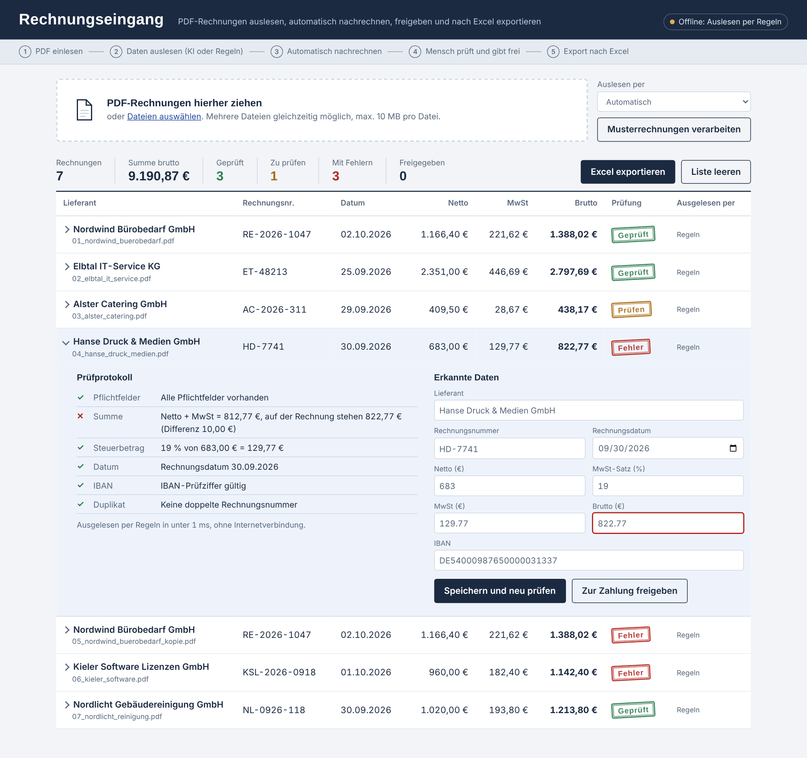

# Rechnungs-Assistent

Ein internes Tool für die Buchhaltung: PDF-Eingangsrechnungen werden per KI ausgelesen, automatisch nachgerechnet, von einem Menschen freigegeben und nach Excel exportiert.



## Das Problem

In vielen Büros werden Lieferantenrechnungen noch von Hand abgetippt. Das kostet Zeit, und typische Fehler fallen oft erst bei der Zahlung auf: Rechenfehler auf der Rechnung, doppelt eingereichte Rechnungen oder eine falsche IBAN.

## Die Lösung

| Schritt | Was passiert |
| --- | --- |
| 1. PDF einlesen | Text wird lokal aus dem PDF gelesen (pdfplumber) |
| 2. Daten auslesen | Claude liefert Lieferant, Nummer, Datum und Beträge als JSON nach festem Schema. Ohne API-Schlüssel oder bei Netzwerkfehlern übernehmen Regeln (reguläre Ausdrücke) |
| 3. Nachrechnen | 7 Prüfregeln: Pflichtfelder, Netto + MwSt = Brutto, Steuerbetrag, Steuersatz, Datum, IBAN-Prüfziffer, Duplikate |
| 4. Freigabe | Ein Mensch korrigiert bei Bedarf und gibt frei. Rechnungen mit Fehlern lassen sich nicht freigeben |
| 5. Export | Excel-Datei mit Rechnungsliste, Summen und vollständigem Prüfprotokoll |

## Datenschutz und Sicherheit

- **Datensparsamkeit:** IBAN und E-Mail-Adressen werden vor dem Senden an die KI maskiert. Die IBAN wird nur lokal erkannt.
- **Prompt-Injection:** Der Rechnungstext wird als Daten markiert. Die KI hat keine Werkzeuge und kann nur JSON nach Schema zurückgeben.
- **Keine Halluzination ohne Kontrolle:** Die KI soll nichts erraten. Jede Zahl wird von festen Regeln nachgerechnet, ein Mensch gibt frei.
- **Schlüssel nicht im Code:** Der API-Schlüssel steht in `.env`, die per `.gitignore` ausgeschlossen ist.
- **Eingaben prüfen:** Nur echte PDF-Dateien bis 10 MB; Texte aus PDFs werden in der Oberfläche maskiert ausgegeben (kein XSS).
- Für den Echtbetrieb: KI-Anbieter mit Auftragsverarbeitungsvertrag (AVV) oder ein lokales Modell.

## Starten

Voraussetzung: Python 3.11 oder neuer.

**Windows:** Doppelklick auf `start_windows.bat`. Beim ersten Start werden die Pakete installiert, danach öffnet sich http://localhost:8000.

**macOS/Linux:** `./start_mac_linux.sh`

**Manuell:**

```bash
python -m venv .venv
.venv\Scripts\activate        # macOS/Linux: source .venv/bin/activate
pip install -r requirements.txt
python scripts/beispielrechnungen_erzeugen.py
python -m uvicorn app.main:app --port 8000
```

**KI-Modus aktivieren:** `.env.example` nach `.env` kopieren und `ANTHROPIC_API_KEY` eintragen. Ohne Schlüssel läuft alles offline mit Regeln.

## Musterrechnungen

`beispielrechnungen/` enthält 7 fiktive Rechnungen (alle Firmen und Bankdaten sind erfunden), die jede Prüfregel zeigen:

| Datei | Erwartetes Ergebnis |
| --- | --- |
| 01_nordwind_buerobedarf.pdf | Geprüft |
| 02_elbtal_it_service.pdf | Geprüft (anderes Layout) |
| 03_alster_catering.pdf | Prüfen: 7 % MwSt, keine IBAN (Lastschrift) |
| 04_hanse_druck_medien.pdf | Fehler: Bruttobetrag 10,00 € zu hoch |
| 05_nordwind_buerobedarf_kopie.pdf | Fehler: Duplikat von 01 |
| 06_kieler_software.pdf | Fehler: Zahlendreher in der IBAN |
| 07_nordlicht_reinigung.pdf | Geprüft |

## Schnittstelle (REST-API)

Die Oberfläche ist nur ein Client: Alle Funktionen laufen über eine REST-API, die auch ein ERP, ein Skript oder ein Power-Automate-Flow nutzen kann. Die interaktive Dokumentation erzeugt FastAPI automatisch unter http://localhost:8000/docs.

| Methode | Pfad | Zweck |
| --- | --- | --- |
| GET | `/api/rechnungen` | Alle Rechnungen mit Prüfprotokoll (JSON) |
| POST | `/api/rechnungen` | PDF-Dateien hochladen (multipart/form-data) |
| PUT | `/api/rechnungen/{id}` | Felder korrigieren, alle Prüfregeln laufen erneut |
| POST | `/api/rechnungen/{id}/freigabe` | Freigeben oder Freigabe zurücknehmen |
| DELETE | `/api/rechnungen` | Liste leeren |
| GET | `/api/export.xlsx` | Excel-Export |
| GET | `/api/status` | KI-Modus und Modell |

Statuscodes: 400 (keine PDF-Datei), 404 (Rechnung unbekannt), 409 (fehlerhafte Rechnung soll freigegeben werden), 413 (Datei über 10 MB), 422 (kein Text im PDF).

`scripts/api_demo.ps1` zeigt den Ablauf in PowerShell: lesen, Freigabe abgelehnt (409), korrigieren, freigeben.

```powershell
pwsh -File scripts\api_demo.ps1 -Neu
```

Für den Produktivbetrieb fehlen noch Anmeldung (z. B. Microsoft Entra ID), HTTPS und eine Versionierung (`/api/v1`).

## Tests

```bash
python -m pytest -q
```

22 Tests: Prüfregeln, Regel-Extraktion aller Musterrechnungen, KI-Extraktion mit einer Attrappe der API (prüft auch, dass keine IBAN gesendet wird), Rückfall auf Regeln bei Netzwerkfehlern und der komplette Ablauf über die Web-API.

## Aufbau

```
app/
  main.py         Web-API (FastAPI) und Ablauf: PDF -> Extraktion -> Prüfung -> Speichern
  extraktion.py   PDF-Text, KI-Extraktion (Claude, JSON-Schema), Regel-Extraktion, Maskierung
  pruefung.py     Die 7 Prüfregeln und der Gesamtstatus
  datenbank.py    SQLite: Speichern, Duplikatsuche, Freigabe
  export.py       Excel-Export mit Summen und Prüfprotokoll
  static/index.html  Oberfläche (HTML, CSS, JavaScript ohne Framework)
scripts/beispielrechnungen_erzeugen.py   Erzeugt die fiktiven Musterrechnungen
scripts/api_demo.ps1                     Vorführung der REST-API in PowerShell
tests/            pytest
```

## Nächste Schritte

- **E-Rechnung:** Seit 2025 müssen alle Unternehmen E-Rechnungen (XRechnung, ZUGFeRD) empfangen können. Deren XML lässt sich ohne KI direkt einlesen; PDF-Rechnungen bleiben in der Übergangszeit bis Ende 2027.
- Gescannte Rechnungen: OCR oder Claude direkt mit dem PDF als Bild
- Lieferanten-Stammdaten: IBAN mit der bekannten Bankverbindung abgleichen (Schutz vor Betrug mit gefälschten Rechnungen)
- Anbindung an ERP oder DATEV per Schnittstelle, Login mit Microsoft Entra ID, Betrieb in Docker

Entwickelt mit KI-Unterstützung (Claude); Code geprüft und getestet.
